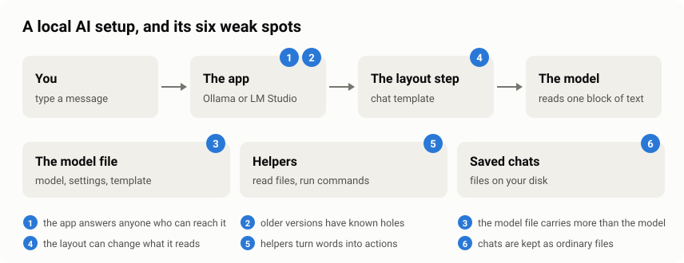
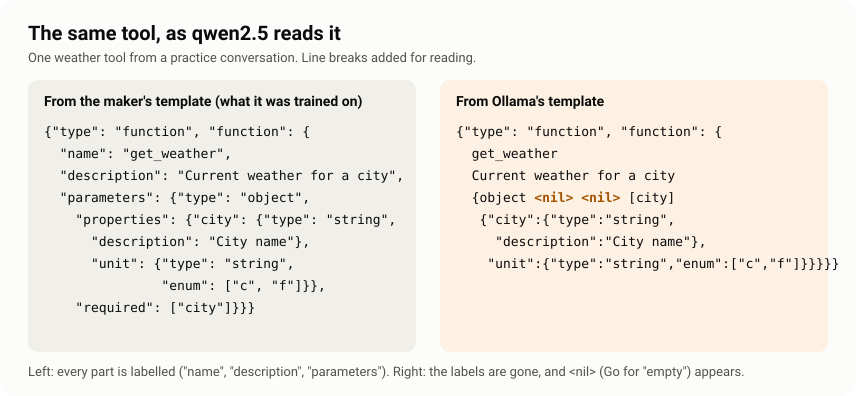
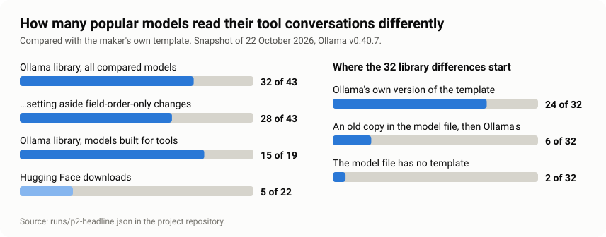

# How safe is your local AI? Six weak spots, explained simply

*Running AI on your own computer keeps your chats off other companies' servers. It doesn't make your setup safe. Here are the six weak spots, what researchers and I found in each, and a ten-minute check-up.*

Local AI apps like **Ollama** and **LM Studio** feel private: the model runs on your own machine,
and nothing goes to a big AI company. But "local" isn't the same as "safe":

- **Ollama has no login.** Anyone who can reach it can use it, change it, and use the ollama.com
  account it's signed in to.
- **Researchers have found 175,108 Ollama servers open to the whole internet**, in 130 countries.
- **Old versions have published holes**, and the servers that run them rarely get updated.
- **For 32 of 43 popular models in Ollama's library, the text the model reads isn't the text its
  maker designed.** I measured that myself, and it changes how well the model uses tools.

This article explains all six weak spots in plain words. For each one: what can happen, what I
found, what it means if you just use AI and if you build with AI, how to check your own computer,
and what to do.

![The six weak spots at a glance: 1 the app answers anyone who can reach it, fix: keep Ollama on 127.0.0.1; 2 older versions have known holes, fix: update to 0.40.8 or later; 3 a model file carries more than the model, fix: get models from the maker or Ollama's library; 4 the layout can change what the model reads, fix: test tool use on the exact model you ship; 5 helpers turn the model's words into actions, fix: one folder, no secrets, approve risky steps; 6 chats are kept as ordinary files, fix: delete old chats and set OLLAMA_NOHISTORY=1](docs/assets/img/glance.svg)

**Contents:** [the short version](#the-short-version) ·
[1. open app](#weak-spot-1-the-app-answers-anyone-who-can-reach-it) ·
[2. old versions](#weak-spot-2-older-versions-have-known-holes) ·
[3. model files](#weak-spot-3-a-model-file-carries-more-than-the-model) ·
[4. layout](#weak-spot-4-the-layout-step-can-change-what-the-model-reads) ·
[5. helpers](#weak-spot-5-helpers-turn-the-models-words-into-actions) ·
[6. saved chats](#weak-spot-6-your-chats-are-kept-as-ordinary-files) ·
[safety checklist](#your-safety-checklist) ·
[Part 2: the tool test](TOOL-TEST.md)

---

## The short version

**If you just use AI on your computer, do these three things today:**

1. Make sure your AI app only accepts connections from your own computer (weak spot 1).
2. Update Ollama to the newest version (weak spot 2).
3. Keep passwords and keys out of any folder an AI helper can read (weak spot 5).

**If you build with AI:**

- Treat a local model server like any other API: it has no login, so don't expose it, and put an
  authenticating proxy in front if a team shares it.
- Pin and patch it like any dependency. Most of Ollama's published holes are reached through the
  same open API.
- The prompt your model reads can differ from the one its maker trained it on, even when you change
  nothing. Compare the rendered prompt, not the template file. For `qwen2.5` the difference cost
  45 of 1,240 answers on a tool benchmark ([Part 2: the tool test](TOOL-TEST.md)).
- Treat the folders your agent can read as its blast radius.

<b>New to this? Nine words explained</b>

- **Model:** the trained AI itself. A large file of numbers that turns text into more text.
- **Ollama, LM Studio:** free apps that download models and run them on your own computer.
- **Hugging Face:** the largest public website for sharing AI models. Anyone can upload.
- **Chat template:** a small set of layout instructions inside the model file. It turns a
  conversation into the one block of text the model reads.
- **Tool:** something a model can ask to use, such as a calculator, a file reader or a web search.
- **Server, port:** a server is a program that waits for messages from other programs. The port
  is the numbered door it listens on. Ollama's is 11434.
- **127.0.0.1:** the address that means "this computer only".
- **API:** the set of requests a program accepts from other programs.
- **CVE:** the ID given to a published security hole, so everyone can refer to the same one.

---

## How a local AI setup works

When you run a model with Ollama or LM Studio, these parts work together. Each number is one of
the six weak spots below.

1. **You** type a message in a chat window or a coding helper.
2. **The app** (Ollama or LM Studio) receives it. It runs quietly in the background. *(Weak spots
   1 and 2.)*
3. **The layout step** uses the chat template to turn the whole conversation into one block of
   text. *(Weak spot 4.)*
4. **The model** reads that block of text, and only that block, and writes its reply.

Alongside sit **the model file** (weak spot 3), **helpers** that let the model act (weak spot 5),
and **saved chats** (weak spot 6).

---

## Weak spot 1: the app answers anyone who can reach it

> **In one line:** Ollama has no login. Whoever can connect to it can use your models, change
> them, and use your ollama.com account.

**In plain words.** Ollama runs a small server on your computer. What keeps you safe is the
address it listens on. Out of the box it only accepts connections from your own computer
(`127.0.0.1`). One setting, `OLLAMA_HOST`, opens it up, and people often change it on purpose so
they can use their model from a phone or a second computer. LM Studio has a switch for the same
thing, **Serve on Local Network**. Once either is on, everyone on the same Wi-Fi can use your AI.
If your router forwards Ollama's port, everyone online can too.

**What I found in Ollama's code.** I read the server code of Ollama 0.40.7 to see exactly what an
open port gives away:

- **There is no login to turn on.** Ollama has a setting called `OLLAMA_AUTH`, but it only makes
  the Ollama command-line program sign the requests *it* sends. The server never asks for it.
- **Your ollama.com account comes with it.** If you've signed Ollama in to an ollama.com account
  (for cloud models or web search), the server passes some requests on to ollama.com, signed with
  your computer's own key, whoever sent them. So anyone who reaches it can see your account's name,
  email and plan, its usage and balance, run cloud models and web searches on it, and sign your
  computer out.
- **Its protection against websites switches off.** Ollama checks the address each request was
  sent to. That blocks a known trick where a web page in your browser quietly talks to your Ollama
  (DNS rebinding). But it only runs this check while Ollama listens on `127.0.0.1`. Once it's open
  to the network, the check is skipped.
- **Which websites may read its answers is one setting.** By default only pages from your own
  computer and a few kinds of app (desktop apps, local files, VS Code panels) can. Every address
  added to `OLLAMA_ORIGINS` lets that website's pages do the same.

**What researchers found.** This isn't rare. Three separate studies counted Ollama servers anyone
on the internet could use:

**If you just use AI:** think of it as leaving your front door open. On home Wi-Fi the risk is
the people and devices on your network. On café, hostel or office Wi-Fi, it's strangers.

**If you build with AI:** a reachable Ollama is an unauthenticated API. It can pull, push, copy
and delete models, and create new ones with any system prompt, and a signed-in server lends out
its ollama.com account. If a team shares one model server, put an authenticating proxy in front
of it, keep the port itself on `127.0.0.1`, and set `OLLAMA_ORIGINS` to the exact sites that need it.

**How to check:** the [check-up](#run-the-check-up-on-your-own-computer) looks at the addresses
your AI apps listen on and at the `OLLAMA_HOST` setting. Or check by hand: on Windows, run
`netstat -ano | findstr 11434`; on a Mac or Linux, `lsof -nP -iTCP:11434 -sTCP:LISTEN`. Seeing
`127.0.0.1:11434` is good. Seeing `0.0.0.0:11434`, `[::]:11434` or `*:11434` means other devices can
connect.

**What to do:**
- Delete `OLLAMA_HOST`, or set it to `127.0.0.1`, then restart Ollama. In LM Studio, turn off
  **Serve on Local Network**.
- If another device really needs it, put a login in front of it. Don't just open the port.
- If you don't use Ollama's cloud models, set `OLLAMA_NO_CLOUD` to `1`, so the server never acts
  for your ollama.com account. Never leave a server open that is signed in.

<b>For engineers: where this is in the code</b>

- Ollama 0.40.7, `server/routes.go`: the only middleware is CORS and `allowedHostsMiddleware`. The
  Host check returns early when the listener isn't a loopback address, so DNS-rebinding protection
  only exists on `127.0.0.1`.
- Routes on the same listener include `/api/chat`, `/api/generate`, `/api/pull`, `/api/push`,
  `/api/create`, `/api/copy`, `/api/delete` and `/api/blobs/:digest`, plus the account routes
  `/api/me` and `/api/signout` and the experimental web search and fetch.
- `server/cloud_proxy.go`: requests for cloud models are signed with the machine's key before
  they're forwarded. `OLLAMA_NO_CLOUD=1`, or `disable_ollama_cloud` in `~/.ollama/server.json`,
  turns the proxy off.
- `envconfig/config.go`: `OLLAMA_AUTH` is read only by the client in `api/client.go`. The default
  allowed origins are `localhost`, `127.0.0.1` and `0.0.0.0` on any port, plus `app://`, `file://`,
  `tauri://`, `vscode-webview://` and `vscode-file://`.

---

## Weak spot 2: older versions have known holes

> **In one line:** Ollama has fixed several serious holes, most of them reached through the same
> open API, and many servers never get the fix.

**In plain words.** Ollama is updated often, and some updates fix security holes. Once a hole is
published, anyone can look up how it works. An old version that others can reach (weak spot 1) is
the worst case.

![Ollama's security fixes: 0.1.34 (7 May 2024) fixed Probllama, taking over the computer through a crafted model download; 0.1.46 (22 June 2024) fixed crashing the app or learning which files exist; 0.1.47 (27 June 2024) fixed writing files outside the models folder through a ZIP upload; 0.17.1 (24 February 2026) fixed Bleeding Llama, reading the app's memory; 0.23.3 (12 May 2026) hardened the Windows updater. Four of the five are reached through Ollama's API. The newest version is 0.40.8, 21 October 2026](docs/assets/img/cves.svg)

The two most serious, in plain words:

- **Probllama (CVE-2024-37032), fixed in 0.1.34.** A request to download a model from a server
  someone else controls could write files anywhere on the computer, and from there take it over.
- **Bleeding Llama (CVE-2026-7482), fixed in 0.17.1.** Sending a specially built model file made
  Ollama read memory it shouldn't, which can hold keys and chats. It uses the
  "create a model" request, so it needs only an Ollama that others can reach.

And updates don't happen by themselves on servers. A study of open Ollama servers over a full
year (Xu and others, IMC 2026) found that, depending on the hole, only **0.43% to 2.90%** of servers
running a version with that hole were updated in place.

**If you just use AI:** this is the same as updating your phone. Old versions have holes that are
public knowledge.

**If you build with AI:** pin the Ollama version in your setup scripts and images, track its
security advisories like any other dependency, and rebuild when a fix lands. Most of these holes
need network access to the API, so closing weak spot 1 also shrinks this one.

**How to check:** run `ollama --version`. The check-up asks your running Ollama for its version
and tells you if it is older than these fixes.

**What to do:** download the latest Ollama from ollama.com and install it over the old one. Your
models stay where they are. The newest version when this was written was 0.40.8 (21 October 2026).

<b>For engineers: the advisories</b>

| Fixed in | Released | CVE | What it is |
|---|---|---|---|
| 0.1.34 | 7 May 2024 | CVE-2024-37032 | Path traversal through a model digest in `/api/pull`, leading to remote code execution (Wiz) |
| 0.1.46 | 22 Jun 2024 | CVE-2024-39720, 39722 | An out-of-bounds read that crashes the server through `/api/create`, and a file-existence leak through `/api/push` (Oligo). Oligo also reported CVE-2024-39721, fixed in 0.1.34, and CVE-2024-39719, listed for versions through 0.3.14 |
| 0.1.47 | 27 Jun 2024 | CVE-2024-45436 | ZIP extraction writes outside the target folder |
| 0.17.1 | 24 Feb 2026 | CVE-2026-7482 | Heap out-of-bounds read through `/api/create`, CVSS 9.1 (Cyera) |
| 0.23.3 | 12 May 2026 | CVE-2026-42248, 42249 | Windows updater didn't verify updates; 0.12.10 to 0.17.5 confirmed affected |

---

## Weak spot 3: a model file carries more than the model

> **In one line:** the instructions that travel with a model can be outdated, rewritten or
> tampered with, and you never see them unless you look.

**In plain words.** A model file isn't only the trained model. It also carries the chat template,
which is a small program, plus default settings. Whoever packages the file decides what goes in
them.

**What I found myself.** My measurement turned up two everyday examples:

- **Outdated copies.** In 9 of 45 model files in Ollama's library, the template inside is an
  older version of the maker's template. For example, the `falcon3` file matches the maker's
  template from 17 December 2024. The next day, the maker published a change called "fix
  chat_template for tool use". The file was made before that fix.
- **Rewritten instructions.** On Hugging Face, two popular custom models replace the maker's
  instructions for using tools with their own wording. They also add a standing instruction about
  how to answer.

Neither is an attack. But others have shown that it can be:

- In 2024 a malicious template was enough to run code on the computer through llama-cpp-python
  (CVE-2024-34359).
- In February 2026, Pillar Security showed that a tampered template can plant a hidden backdoor
  that passes a model hub's automated scans, across 18 models and 4 engines.

**If you just use AI:** where you download a model from matters. The maker's official release or
Ollama's own library is the safer default, especially for a model that can use tools.

**If you build with AI:** a template is code from the same source as the weights. Render it only
in a sandbox. When a template differs from the maker's, check the maker's repository history
before you conclude anything: in my data, the usual reason was an older version.

**How to check:** the check-up lists where each of your models came from (Ollama's library, or a
named uploader on Hugging Face). It also reads each template for two unusual things: a web
address, or a rule that reacts when you type particular words. I tested that warning on 95 real
templates. It went off for 3, and all 3 were ordinary, visible features, such as a word that
switches a model's "thinking" mode on or off. So it's rare, and worth a look when it happens.

**What to do:** for anything that uses tools, prefer the maker's official release or Ollama's
library. If the warning appears and you didn't expect it, remove the model (`ollama rm <name>`)
and get it from the maker's official source.

---

## Weak spot 4: the layout step can change what the model reads

> **In one line:** for 32 of 43 popular models in Ollama's library, the text the model reads when
> it uses tools isn't the text its maker designed, and that changes its answers.

This is the weak spot I measured, because I couldn't find anyone who had counted it.

**In plain words.** A model learns to read conversations laid out in one exact way: who is
speaking, where the instructions go, how a tool is described, how a tool's answer comes back. Its
maker publishes the chat template that produces that layout. If the app lays the conversation out
differently, the model is reading something it wasn't trained on. It's like being handed a
familiar form where the boxes have moved.

### An example you can see

Here is one tool from my measurement, for `qwen2.5`, as the model reads it each way:

In the maker's version every part is labelled: `"name"`, `"description"`, `"parameters"`. In
Ollama's, the labels are gone, and `<nil>` (the Go programming language's word for "empty")
appears where they were. The model was trained to read the first one.

### How the template travels, and where it changes

A chat template is copied twice on its way to the model: into the model file, and then often into
Ollama's own version. I compared all three.

### What I found

- **32 of 43 library models read their tool conversations differently** from what their maker
  designed: a tool's answer missing, an instruction added or dropped, tools described in another
  format.
- **28 of 43 if you set aside the mildest kind.** In four of the 32, the only change is the order
  of the fields in a tool's description.
- **15 of 19 among models built for tools** (11 without the order-only cases).
- **Most differences come from Ollama's own version of the template:** 24 of the 32. In 6 the
  model file already holds an older copy; in 2 it has no template of its own.
- **Hugging Face downloads fare better:** 5 of 22 differ, and in all 5 the difference is already
  in the uploaded file.
- **A template that looks different can still be fine.** In 7 Hugging Face models the template
  text differs from the maker's, yet all twelve test conversations came out exactly the same.

### Does it change what the model does? Yes

Formatting alone, such as separators and spaces, can move a model's accuracy by up to 76
percentage points on some tasks (Sclar and others, ICLR 2024). I tested it directly on tool use.
On 1,240 questions from a public tool benchmark, the same `qwen2.5` on the same server got
**1,034 right with Ollama's layout and 1,079 with the maker's: 83.4% against 87.0%**. With
Ollama's layout it more often called a tool when none fitted the question.

**→ [Read Part 2: the tool test](TOOL-TEST.md)** for the full method, the categories and the
statistics.

**If you just use AI:** if a local model is clumsy with tools, the layout may be part of the
reason, not only the model. Some models came out with no difference at all: check the
[results page](https://mohanvishe.github.io/template-drift-audit/results.html) for yours.

**If you build with AI:**
- Look at what Ollama runs: `ollama show --modelfile <model>` prints the package's template. On
  Ollama 0.40.7 or newer, `/api/show` also reports `template_source`.
- Diff rendered prompts, not template files. The model receives a string, and that string is what
  you should compare.
- Pin the reference in time: "the original" as of when?
- If you depend on tool calling, test it on the exact package you ship, and consider setting your
  own `TEMPLATE` in a Modelfile when the shipped one drifts.

<b>For engineers: how I measured it</b>

1. **Models.** The 50 most popular chat models in Ollama's library and the 30 most downloaded
   chat models on Hugging Face, as of 22 October 2026.
2. **Set aside, with a reason.** Some makers never published a template, and five Hugging Face
   files couldn't be read. That left **65 models**: 43 from the library and 22 from Hugging Face.
   The [results page](https://mohanvishe.github.io/template-drift-audit/results.html) lists every
   model left out and why.
3. **Twelve harmless practice conversations**, six of them with tools: a tool list, a tool request
   and its answer, two requests at once, and so on.
4. **Each conversation rendered three ways:** with the maker's Jinja template (the reference, L0),
   with the copy in the GGUF header (L1), and with what Ollama actually runs (L3).
5. **Compared with the maker's** and sorted by kind of difference. Whitespace, line breaks and the
   date don't count.

For 41 of the 45 library model files, the Ollama step runs Ollama's own Go template and renderer
code, so nothing is guessed. For three others, and for the Hugging Face models, it is a close
Python copy. `gpt-oss` uses Ollama's separate "harmony" format, which this study doesn't
reproduce, and `translategemma`'s maker template can't show a tool conversation, so neither is
scored. That leaves 43.

It ran with no GPU and no model downloads: the tool reads only the GGUF header (7.3 MB for
`qwen2.5`, out of a multi-gigabyte file).

**One model, all three kinds of drift: `qwen2.5`.** The file holds the maker's template as of
18 September 2024, updated the next day. Ollama's version describes tools in Go's default format,
already reported as issue #14601, and the same format reaches 4 of the 43 library models (`qwen2`,
`qwen2.5`, `qwen2.5-coder`, `qwen3`). And a popular Hugging Face copy, bartowski's, matches the
maker's template inside the file, but Hugging Face supplies its own Ollama template for it, which
leaves out the maker's default system instruction.

---

## Weak spot 5: helpers turn the model's words into actions

> **In one line:** once a model can read files or run commands, text hidden in a web page or file
> can steer it, and what it can reach is what's at risk.

**In plain words.** On its own, a model only writes text. Connect a helper that can read files,
run commands or browse, and its text becomes actions on your computer. Two things can then go
wrong:

- **The model is misled by what it reads.** A web page, an email or a file can hold text written
  to give the AI orders. The model can't reliably tell those apart from yours. This is called
  **prompt injection**, and OWASP, a long-standing security community, lists it as the number one
  risk for AI applications.
- **The model makes a mistake.** The layout problems in weak spot 4 make that more likely. In
  the tool test, `qwen2.5` with Ollama's layout called a tool when none fitted the question 93
  times out of 240, against 78 with its maker's layout.

**If you just use AI:** only point an AI helper at the folder it needs, and read what it plans to
do before you let it run commands.

**If you build with AI:** treat everything the model reads (pages, files, tool results) as
untrusted input. Give each agent the least access that works, keep secrets in a secret store
rather than in the working folder, and ask for approval before actions that are hard to undo.

**How to check:** point the check-up at the folder your helper works in. It lists any file whose
name suggests it holds a secret, such as `.env` or a private key. It reads only the names, never
the contents.

**What to do:** move secret files out of the folders you let an AI helper work in, or give the
helper its own folder with only what it needs.

---

## Weak spot 6: your chats are kept as ordinary files

> **In one line:** "local" means your conversations sit on your disk, where anything that can read
> your files can read them too.

**What I found myself.** I went through Ollama's code and LM Studio's documentation to see where
chats end up:

- **Ollama in a terminal** keeps the last 100 lines you typed in `.ollama/history` in your home
  folder, unless you set `OLLAMA_NOHISTORY`.
- **The Ollama desktop app** keeps its chats in a database file in its app folder.
- **LM Studio** keeps each chat as a file in `.lmstudio/conversations` in your home folder.
- **A debugging setting**, `OLLAMA_DEBUG_LOG_REQUESTS`, writes the full text of every request to
  your temp folder. It's off unless someone turns it on.

None of this is a fault. But backup and sync tools copy these files like any others, and anyone
who uses your account can open them.

**If you just use AI:** treat your AI chats like any other private document on your computer.

**If you build with AI:** request logging is useful while you debug and a leak afterwards. Turn it
off when you're done, and keep chat folders out of shared drives and sync.

**How to check:** the check-up lists where your chats are saved and how big those files are,
without opening them. It warns you if the debugging setting is on.

**What to do:** delete old chats you don't need from inside the app. Set `OLLAMA_NOHISTORY` to `1`
to stop the terminal history. If the debugging setting is on, remove it and delete the
`ollama-request-logs-` folders in your temp folder.

---

## Your safety checklist

Tick these off once. Each links back to its weak spot.

- [ ] Ollama listens only on `127.0.0.1`, and LM Studio's **Serve on Local Network** is off ([1](#weak-spot-1-the-app-answers-anyone-who-can-reach-it))
- [ ] `OLLAMA_NO_CLOUD` is `1`, unless you use Ollama's cloud models ([1](#weak-spot-1-the-app-answers-anyone-who-can-reach-it))
- [ ] `OLLAMA_ORIGINS` is empty, or lists only sites you trust ([1](#weak-spot-1-the-app-answers-anyone-who-can-reach-it))
- [ ] Ollama is 0.40.8 or newer ([2](#weak-spot-2-older-versions-have-known-holes))
- [ ] Models that use tools come from the maker or Ollama's library ([3](#weak-spot-3-a-model-file-carries-more-than-the-model))
- [ ] If you build with tool calling, you've tested it on the exact model you ship ([4](#weak-spot-4-the-layout-step-can-change-what-the-model-reads))
- [ ] No `.env` files or private keys in folders an AI helper can read ([5](#weak-spot-5-helpers-turn-the-models-words-into-actions))
- [ ] `OLLAMA_NOHISTORY` is `1` and `OLLAMA_DEBUG_LOG_REQUESTS` is off ([6](#weak-spot-6-your-chats-are-kept-as-ordinary-files))

---

## Run the check-up on your own computer

It takes about ten minutes and needs only Python. It changes nothing, sends nothing anywhere, and
never opens your files or chats.

1. Install Python from python.org. On Windows, tick **Add python.exe to PATH**.
2. Download the project from GitHub (green **Code** button, then **Download ZIP**) and unzip it.
3. Open a terminal in that folder.
4. Open Ollama or LM Studio, so the check-up can see it.
5. Type `python -m tda check` and press Enter. On a Mac or Linux, use `python3`. To also check the
   folder your AI helper works in, add `--folder "<that folder>"`.

Each answer starts with `[OK]` (all good), `[!!]` (worth fixing, with what to do) or `[--]` (for
information). The [step-by-step guide](https://mohanvishe.github.io/template-drift-audit/guide.html)
has pictures.

---

## What this shows, and its limits

- **A clean check-up looks for known warning signs.** It can't prove a model or an app is
  trustworthy.
- **The layout changes what the model does.** For `qwen2.5`, the maker's layout gave 3 to 4 more
  correct tool answers in every 100, whichever program read the replies
  ([Part 2: the tool test](TOOL-TEST.md)). Next: more models, and conversations with several turns.
- **The measurement is a snapshot** of the most popular models on 22 October 2026, with Ollama
  0.40.7. The exposure counts come from other researchers' scans, with their own methods and dates.
- **For the Hugging Face models and three library models,** Ollama fills in the template with a
  separate engine. I reproduced it in Python: very close, not byte for byte.
- **Every number from my measurement comes from a run of the tool.** The code, the raw data and
  the full results, model by model, are public.

---

## Credits

Kai's video *Your Local AI Is Not as Private as You Think* (@kaiexplainsYT, October 2026) gave me
the starting point. It covers weak spots 1, 2, 3 and 5 from the security side, and is worth
watching. For those, this article goes back to the original advisories and research. The rest is
my own work: reading Ollama's code for what an open port exposes (weak spot 1), the measurement of
65 models (weak spot 4), the evidence on old and rewritten templates (weak spot 3), where chats are
saved (weak spot 6), the tool test, and the check-up.

---

## Links

- Website, with the check-up guide and full results: https://mohanvishe.github.io/template-drift-audit/
- Part 2, the tool test: [TOOL-TEST.md](TOOL-TEST.md)
- Code and data: https://github.com/MohanVishe/template-drift-audit

## Sources

- Kai, *Your Local AI Is Not as Private as You Think*, YouTube, October 2026.
  https://www.youtube.com/watch?v=3mx84MRj8lY
- Ollama source code, version 0.40.7: `server/routes.go`, `server/cloud_proxy.go`,
  `envconfig/config.go`, `api/client.go`, `readline/history.go`, `server/inference_request_log.go`,
  `internal/onboarding/app_state.go`.
- Ollama release notes for 0.1.34, 0.1.46, 0.1.47, 0.17.1, 0.23.3 and 0.40.8, and issue #14601.
- GitHub Advisory Database and NVD: CVE-2024-37032, CVE-2024-39719 to CVE-2024-39722,
  CVE-2024-45436, CVE-2026-7482, CVE-2026-42248, CVE-2026-42249, CVE-2024-34359.
- Wiz Research, "Probllama: Ollama Remote Code Execution Vulnerability", 2024.
  https://www.wiz.io/blog/probllama-ollama-vulnerability-cve-2024-37032
- Oligo Security, "More Models, More ProbLLMs", 2024.
  https://www.oligo.security/blog/more-models-more-probllms
- Cyera, "Bleeding Llama: Critical Unauthenticated Memory Leak in Ollama", May 2026.
  https://www.cyera.com/research/bleeding-llama-critical-unauthenticated-memory-leak-in-ollama
- SentinelLABS and Censys, "Silent Brothers: Ollama Hosts Form Anonymous AI Network", January 2026.
  https://www.sentinelone.com/labs/silent-brothers-ollama-hosts-form-anonymous-ai-network-beyond-platform-guardrails/
- Cisco, "Detecting Exposed LLM Servers: A Shodan Case Study on Ollama", September 2025.
  https://blogs.cisco.com/security/detecting-exposed-llm-servers-shodan-case-study-on-ollama
- Xu and others, "Ollama in the Wild", IMC 2026. https://arxiv.org/abs/2609.07115
- Pillar Security, chat template backdoors across 18 models and 4 engines, February 2026.
- LM Studio documentation, "Manage chats".
- OWASP Top 10 for LLM Applications 2025, LLM01: Prompt Injection.
- Sclar, Choi, Tsvetkov and Suhr, "Quantifying Language Models' Sensitivity to Spurious Features
  in Prompt Design", ICLR 2024.
- This project's measurement runs of 22 October 2026, published with the code.
