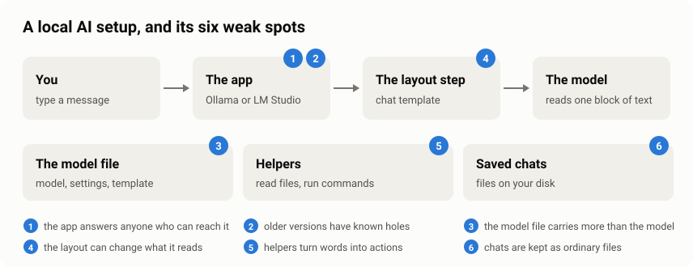
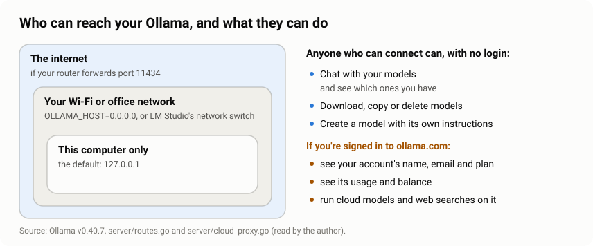
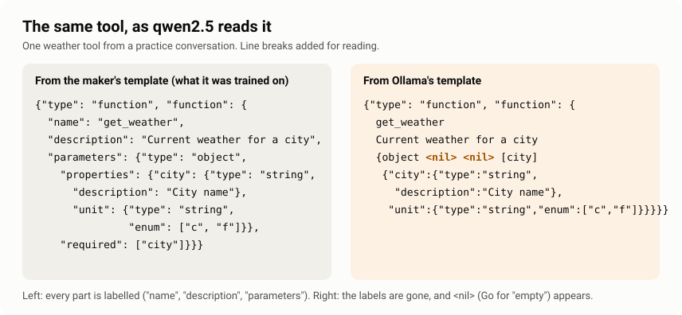
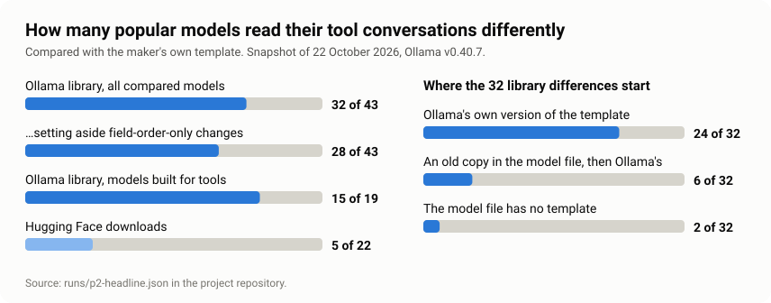

# Running AI locally: six weak spots, explained simply

*What can go wrong when you run AI models on your own computer, how to check your own setup in
ten minutes, and what I found when I measured 65 popular models.*

I took 43 of the most popular models in Ollama's library and checked the exact text each one is
given when you use it with tools. **For 32 of them, it isn't the text the model's maker designed.**

That is one of six weak spots in a local AI setup. This article explains all six in plain words.
For each one it says what it means if you simply use AI, what it means if you build with AI, how
to check it on your own computer, and what to do about it.

This started from Kai's video *Your Local AI Is Not as Private as You Think* (@kaiexplainsYT,
October 2026), which explains the security side of local AI well. I followed its leads back to the
original sources, read Ollama's code myself, and measured the part I couldn't find anyone counting:
the text the model actually reads.

---

## The short version

**If you just use AI on your computer:**
- Running AI locally keeps your chats off other companies' computers. That is a real benefit.
  It doesn't make your setup safe by itself.
- Three things to do today:
  1. Make sure your AI app only accepts connections from your own computer (weak spot 1).
  2. Update Ollama (weak spot 2).
  3. Keep passwords and keys out of any folder an AI helper can read (weak spot 5).
- A free check-up tells you where you stand in about ten minutes. It changes nothing and sends
  nothing anywhere.

**If you build with AI:**
- The prompt your model actually reads can differ from the one its maker trained it on, even when
  you change nothing. In Ollama's library this held for 32 of 43 models on the tool-calling
  conversations I tested.
- Compare the rendered prompt, not the template file. Two templates can look different and give
  the same text, or look alike and give different text.
- Treat a model's template as code that comes with the model, and the folders your agent can read
  as its blast radius.

---

## A few words first

You only need these to follow the rest.

- **Model:** the trained AI itself. A large file of numbers that turns text into more text.
- **Ollama, LM Studio:** free apps that download models and run them on your own computer.
- **Hugging Face:** the largest public website for sharing AI models. Anyone can upload.
- **Chat template:** a small set of layout instructions inside the model file. It turns a
  conversation into the one block of text the model reads.
- **Tool:** something a model can ask to use, such as a calculator, a file reader or a web search.
- **Server, port:** a server is a program that waits for messages from other programs. The port
  is the numbered door it listens on. Ollama's is 11434.
- **127.0.0.1:** the address that means "this computer only".
- **JSON:** a standard way of writing data so that programs and models can read it.
- **CVE:** the ID given to a published security problem, so everyone can refer to the same one.

---

## How a local AI setup works

When you run a model with Ollama or LM Studio, these parts work together:

1. **You** type a message in a chat window or a coding helper.
2. **The app** (Ollama or LM Studio) receives it. It runs quietly in the background. *(Weak spots
   1 and 2.)*
3. **The layout step** uses the chat template to turn the whole conversation into one block of
   text. *(Weak spot 4.)*
4. **The model** reads that block of text, and only that block, and writes its reply.

Three more things sit alongside:

- **The model file:** the model, its default settings and its chat template. *(Weak spot 3.)*
- **Helpers:** tools that let the model read files, run commands or browse. *(Weak spot 5.)*
- **Saved chats:** your conversations, kept as files on your disk. *(Weak spot 6.)*

Each part can go wrong in its own way. Here is each one.

---

## Weak spot 1: the app answers anyone who can reach it

**In plain words.** Ollama runs a small server on your computer. It has no login. Anyone who can
connect to it can do everything you can: chat with your models, download new ones, delete them,
or create a new model with its own instructions. These are ordinary features, listed in Ollama's
own code.

What keeps you safe is the address it listens on. Out of the box, Ollama only accepts connections
from your own computer, through `127.0.0.1`. One setting, `OLLAMA_HOST`, changes that. People
often change it on purpose, so they can use their model from a phone or a second computer.
LM Studio has a switch for the same thing, called **Serve on Local Network**. Once either is on,
everyone on the same Wi-Fi can use your AI. If your router forwards Ollama's port to the internet,
everyone online can too.

**What I found in Ollama's code.** I read the server code of Ollama 0.40.7 to see exactly what an
open port gives away. Three things stood out:

- **Its protection against websites switches off.** Ollama checks which address each request was
  sent to. That blocks a known trick where a web page in your browser quietly talks to your
  Ollama (called DNS rebinding). But the code runs this check only while Ollama listens on
  `127.0.0.1`. Once it is open to the network, the check is skipped.
- **Your ollama.com account comes with it.** If you have signed Ollama in to an ollama.com account
  (for cloud models or web search), the server forwards some requests to ollama.com signed with
  your computer's own key, whoever sent them. So anyone who can reach it can read your account's
  name, email and plan, see its usage and balance, and run cloud models and web searches on it.
- **Which websites may talk to it is one setting.** By default, only pages served from your own
  computer and a few kinds of app (desktop apps, local files, VS Code panels) can read Ollama's
  answers in a browser. Every address you add to `OLLAMA_ORIGINS` lets that website's pages do the
  same.

**If you just use AI:** think of it as leaving your front door open. On home Wi-Fi the risk is
the people and devices on your network. On café, hostel or office Wi-Fi, it is strangers.

**If you build with AI:** a reachable Ollama is an unauthenticated API. It can pull and delete
models and create new ones with any system prompt, and a signed-in server lends out its ollama.com
account. If a team shares one model server, put an authenticating proxy in front of it rather than
exposing the port, and keep `OLLAMA_ORIGINS` to the exact sites that need it.

**How to check:** the check-up looks at the addresses your AI apps listen on and at the
`OLLAMA_HOST` setting. It tells you if anything other than your own computer can connect.

**What to do:** delete `OLLAMA_HOST`, or set it to `127.0.0.1`, then restart Ollama. In LM Studio,
turn off **Serve on Local Network**. If you really need another device to reach it, put a login in
front of it. Don't leave the port open, and never on a server that is signed in to ollama.com.

---

## Weak spot 2: older versions have known holes

**In plain words.** Ollama is updated often, and some updates fix security problems. Two recent
ones show why updating matters:

- **A crafted model upload could leak memory (CVE-2026-7482).** Before version 0.17.1, sending
  Ollama a specially built model file made it read memory it shouldn't. The upload uses the
  "create a model" feature from weak spot 1, so an app that others can reach is exposed to this
  too.
- **The Windows updater accepted unchecked updates (CVE-2026-42248 and CVE-2026-42249).** Ollama
  for Windows didn't verify that a downloaded update was genuine. Versions 0.12.10 to 0.17.5 were
  confirmed affected. Ollama 0.23.3 hardened its update process.

The newest Ollama when this was written is 0.40.8, released on 21 October 2026.

**If you just use AI:** this is the same as updating your phone. Old versions have holes that are
public knowledge.

**If you build with AI:** pin the Ollama version in your setup scripts and images, and track its
security advisories like any other dependency. Weak spots 1 and 2 add up: an exposed, old server is
the worst case.

**How to check:** the check-up asks your running Ollama for its version and compares it with these
fixes.

**What to do:** download the latest Ollama from ollama.com and install it over the old one. Your
models stay where they are.

---

## Weak spot 3: a model file carries more than the model

**In plain words.** A model file isn't only the trained model. It also carries the chat template,
which is a small program, plus default settings. Whoever packages the file decides what goes in
them, and you never see them unless you go looking.

**What I found myself.** My measurement turned up two everyday examples:

- **Outdated copies.** In 9 of 45 model files in Ollama's library, the template inside is an
  older version of the maker's template. For example, the `falcon3` file matches the maker's
  template from 17 December 2024. The next day, the maker published a change called "fix
  chat_template for tool use". The file was simply made before that fix.
- **Rewritten instructions.** On Hugging Face, two popular custom models replace the maker's
  instructions for using tools with their own wording. They also add a standing instruction about
  how to answer.

Neither is an attack. But they show that the instructions travelling with a model can change
between its maker and your computer.

**If you just use AI:** where you download a model from matters. The maker's official release or
Ollama's own library is the safer default, especially for a model that can use tools.

**If you build with AI:** a template is code from the same source as the weights. In 2024 a
malicious template was enough for remote code execution in llama-cpp-python (CVE-2024-34359).
In February 2026, Pillar Security showed that a tampered template can plant a hidden backdoor
that passes a hub's automated scans. Render templates only in a sandbox. When a template differs
from the maker's, check the maker's repository history before you conclude anything: in my data,
the usual reason was an older version.

**How to check:** the check-up lists where each of your models came from: Ollama's own library,
or a named uploader on Hugging Face. It also reads each template for two unusual things: a web
address, or a rule that reacts when you type particular words. I tested that warning on 95 real
templates. It went off for 3, and all 3 turned out to be ordinary, visible features, such as a
word that switches a model's "thinking" mode on or off. So it is rare, and worth a look when it
happens.

**What to do:** for anything that uses tools, prefer the maker's official release or Ollama's
own library. If the warning appears and you didn't expect it, remove the model
(`ollama rm <name>`) and get it from the maker's official source.

---

## Weak spot 4: the layout step can change what the model reads

This is the weak spot I measured, because I couldn't find anyone who had counted it.

**In plain words.** A model learns to read conversations laid out in one exact way: who is
speaking, where the instructions go, how a tool is described, how a tool's answer comes back. Its
maker publishes the chat template that produces that layout. If the app lays the conversation out
differently, the model is reading something it wasn't trained on. It's like being handed a
familiar form where the boxes have moved.

Does that matter? Researchers have shown that formatting alone, such as which separators and
spaces a prompt uses, can move a model's accuracy by up to 76 percentage points on some tasks
(Sclar and others, ICLR 2024). That study used a different kind of prompt, and my measurement
doesn't measure accuracy. So read it as "layout matters", not as a number for these models.

### An example you can see

Here is one tool from my measurement, for `qwen2.5`, as the model reads it each way.

In the maker's version, every part is labelled: `"name"`, `"description"`, `"parameters"`. In
Ollama's, the labels are gone, and `<nil>` (the Go programming language's word for "empty")
appears where they were. The model was trained to read the first one.

### What I measured, step by step

1. **I picked the models.** The 50 most popular chat models in Ollama's library and the 30 most
   downloaded chat models on Hugging Face, as they were on 22 October 2026.
2. **I set some aside, with a written reason for each.** For example, some makers never published
   a template, so there is nothing to compare against. That left **65 models**: 43 from Ollama's
   library and 22 from Hugging Face.
3. **I wrote twelve harmless practice conversations.** Six of them use tools: a tool list, a tool
   request and its answer, two requests at once, and so on.
4. **I turned each conversation into the text the model reads, three ways:**
   - with the maker's template (the reference);
   - with the copy of the template inside the model file;
   - with what Ollama actually uses, which is often Ollama's own rewritten version.
5. **I compared the results with the maker's**, and sorted each difference by kind: a tool's
   answer missing, an instruction added or dropped, tools written in another format, and so on.
   Changes to spaces, line breaks or the date don't count.

For 41 of the 45 library model files, the Ollama step runs Ollama's own code, so nothing is
guessed. For three others, and for the Hugging Face models, it is a close copy written in Python.

All of this ran on my local setup with no GPU and no model downloads. The tool reads only the
small header of each model file, not the model itself. For `qwen2.5` that was 7.3 MB of a
multi-gigabyte file.

### What I found

- **In Ollama's library, 32 of 43 models read their tool conversations differently from what
  their maker designed.** "Differently" means a change to what the model is told: a tool's answer
  missing, an instruction added or dropped, tools described in another format.
- **28 of 43, if you set aside the mildest kind.** In four of the 32, the only change is the order
  of the fields in a tool's description.
- **15 of 19 among models built for tools.** Some models in the list weren't made for tools at
  all. Counting only the 19 whose maker's template shows the model a list of tools, 15 differ, or
  11 without the order-only cases.
- **Most differences come from Ollama's own version of the template.** In 24 of the 32, the copy
  inside the model file matches the maker's, apart from harmless spacing. In 6, the model file
  already holds an older copy, and Ollama's version changes it further. In 2, the model file has
  no template of its own to compare.
- **Hugging Face downloads fare better.** For all 22 measured, Ollama used the template inside the
  file. Only 5 differ, and in all 5 the difference is already in the uploaded file. Ollama adds no
  meaningful change of its own.
- **A template that looks different can still be fine.** In 7 of the Hugging Face models, the
  template text differs from the maker's, yet all twelve conversations came out exactly the same.

### One model, step by step: qwen2.5

`qwen2.5` is the fourth most popular chat model in Ollama's library. It shows all three kinds of
drift:

1. **The model file holds an outdated template.** It matches the maker's template as it was on
   18 September 2024. The maker updated it the next day.
2. **Ollama's version describes tools in the wrong format,** as in the example above. This is
   already reported to Ollama (issue #14601), and fixes have been proposed. My measurement shows
   how far it reaches: 4 of the 43 library models (`qwen2`, `qwen2.5`, `qwen2.5-coder` and
   `qwen3`).
3. **A popular Hugging Face copy loses a default instruction.** In an earlier test of
   bartowski's widely used copy of this model, the template inside the file matched the maker's
   exactly. But Hugging Face supplies its own Ollama-style template for it, and Ollama uses that
   one. It leaves out the short default instruction the maker's template adds when you don't
   write one yourself.

**If you just use AI:** if a local model is clumsy with tools, the layout may be part of the
reason, not only the model. Check the results page for your model: some models came out with no
difference at all.

**If you build with AI:**
- Look at what Ollama runs. `ollama show --modelfile <model>` prints the package's template. On
  Ollama 0.40.7 or newer, `/api/show` also reports `template_source`, the source Ollama chose.
- Diff rendered prompts, not template files. The model receives a string, and that string is what
  you should compare.
- Pin the reference in time. "Compare against the original" needs one more question: the original
  as of when?
- If you depend on tool calling, test it on the exact package you ship, and consider setting your
  own `TEMPLATE` in a Modelfile when the shipped one drifts.

**How to check:** the full comparison is in the project's repository, with every result. The quick
check-up covers the parts you can act on: where your models came from, and whether their templates
have warning signs.

---

## Weak spot 5: helpers turn the model's words into actions

**In plain words.** On its own, a model only writes text. Once you connect a helper that can read
files, run commands or browse, its text becomes actions on your computer. Two things can then go
wrong:

- **The model makes a mistake.** The layout problems in weak spot 4 can make that more likely.
- **The model is misled by what it reads.** A web page, an email or a file can contain text
  written to give the AI orders. The model can't reliably tell those apart from yours. This is
  called **prompt injection**. OWASP, a long-standing security community, lists it as the number
  one risk for AI applications.

Either way, what the helper can reach is what's at risk. Project folders often hold a file called
`.env` with passwords and keys, or a private key for logging in to servers.

**If you just use AI:** only point an AI helper at the folder it needs, and read what it plans to
do before you let it run commands.

**If you build with AI:** treat everything the model reads (pages, files, tool results) as
untrusted input. Give each agent the least access that works, keep secrets in a secret store
rather than in the working folder, and ask for approval before actions that are hard to undo.

**How to check:** point the check-up at the folder your helper works in. It lists any file whose
name suggests it holds a secret. It reads only the names, never the contents.

**What to do:** move secret files out of the folders you let an AI helper work in, or give the
helper its own folder with only what it needs.

---

## Weak spot 6: your chats are kept as ordinary files

**In plain words.** "Local" means your conversations stay on your computer. It also means they sit
on your disk, where anything that can read your files can read them too.

**What I found myself.** I went through Ollama's code and LM Studio's documentation to see where
chats actually end up:

- **Ollama in a terminal** keeps the last 100 lines you typed in a file called `.ollama/history`
  in your home folder, unless you set `OLLAMA_NOHISTORY`.
- **The Ollama desktop app** keeps its chats in a database file in its app folder.
- **LM Studio** keeps each chat as a file in `.lmstudio/conversations` in your home folder.
- **A debugging setting**, `OLLAMA_DEBUG_LOG_REQUESTS`, writes the full text of every request to
  your temp folder. It's off unless someone turns it on.

None of this is a fault. But backup and sync tools copy these files like any others, and anyone
who uses your account can open them.

**If you just use AI:** treat your AI chats like any other private document on your computer.

**If you build with AI:** request logging is useful while you debug and a leak afterwards. Turn it
off when you are done, and keep chat folders out of shared drives and sync.

**How to check:** the check-up lists where your chats are saved and how big those files are,
without opening them. It warns you if the debugging setting is on.

**What to do:** delete old chats you don't need from inside the app. Set `OLLAMA_NOHISTORY` to `1`
to stop the terminal history. If the debugging setting is on, remove it and delete the
`ollama-request-logs-` folders in your temp folder.

---

## Run the check-up on your own computer

It takes about ten minutes and needs only Python.

1. Install Python from python.org. On Windows, tick **Add python.exe to PATH**.
2. Download the project from GitHub (green **Code** button, then **Download ZIP**) and unzip it.
3. Open a terminal in that folder.
4. Open Ollama or LM Studio, so the check-up can see it.
5. Type `python -m tda check` and press Enter. On a Mac or Linux, use `python3`. To also check the
   folder your AI helper works in, add `--folder "<that folder>"`.

Each answer starts with `[OK]` (all good), `[!!]` (worth fixing, with what to do) or `[--]` (for
information). It changes nothing, sends nothing anywhere, and never opens your files or chats.

---

## What this shows, and what comes next

- **A clean check-up looks for known warning signs.** It can't prove a model or an app is
  trustworthy.
- **A different layout shows the model reads something it wasn't trained on.** How much that
  changes its tool use is the next measurement, and I've already built and tested the harness for
  it.
- **The results are a snapshot** of the most popular models on 22 October 2026, with Ollama 0.40.7.
- **For the Hugging Face models and three library models,** Ollama fills in the template with a
  separate engine. I reproduced that engine's behaviour in Python: very close, not byte-for-byte.
- **Every number here comes from a run of the tool.** The code, the raw data and the full results,
  model by model, are public.

---

## Credits

Kai's video *Your Local AI Is Not as Private as You Think* (@kaiexplainsYT, October 2026) gave me
the starting point. It covers weak spots 1, 2, 3 and 5 from the security side, and is worth
watching. For those, this article cites the original advisories and research. The rest is my own
work: the measurement of 65 models (weak spot 4), the evidence on old and rewritten templates
(weak spot 3), what Ollama's code exposes on an open port (weak spot 1), where chats are saved
(weak spot 6), and the check-up.

---

## Links

- Website, with the step-by-step check-up guide and full results:
  https://mohanvishe.github.io/template-drift-audit/
- Code and data: https://github.com/MohanVishe/template-drift-audit

## Sources

- Kai, *Your Local AI Is Not as Private as You Think*, YouTube, October 2026.
  https://www.youtube.com/watch?v=3mx84MRj8lY
- Ollama source code, version 0.40.7: `server/routes.go`, `server/cloud_proxy.go`, `envconfig/config.go`,
  `readline/history.go`, `internal/onboarding/app_state.go`.
- Ollama release notes for 0.23.3 and 0.40.8, and issue #14601.
- GitHub Advisory Database: CVE-2026-7482, CVE-2026-42248, CVE-2026-42249, CVE-2024-34359.
- Pillar Security, chat template backdoors across 18 models and 4 engines, February 2026.
- LM Studio documentation, "Manage chats".
- OWASP Top 10 for LLM Applications 2025, LLM01: Prompt Injection.
- Sclar, Choi, Tsvetkov and Suhr, "Quantifying Language Models' Sensitivity to Spurious Features
  in Prompt Design", ICLR 2024.
- This project's measurement runs of 22 October 2026, published with the code.
