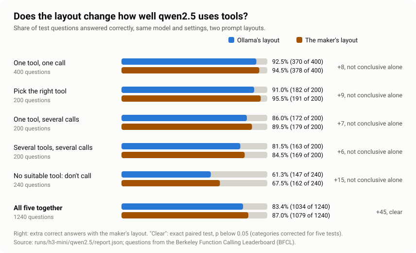
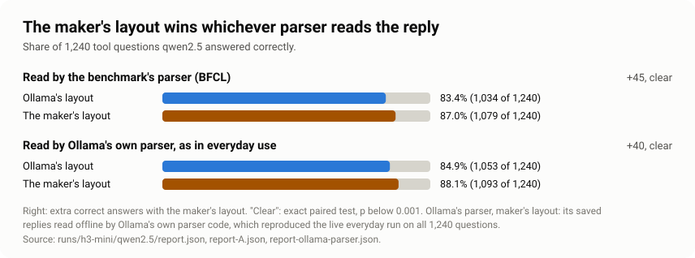

# Does the layout change how well a model uses tools?

The <a href="./">main article</a> showed that for 32 of 43 popular models in
Ollama's library, the text the model reads when it uses tools isn't the text its maker designed.
The obvious next question: does that change what the model does? I tested one model, qwen2.5, on
1,240 tool questions, once with each layout. With the maker's layout it answered 3 to 4 more in
every 100 correctly, whichever program read its replies.

83.4% → 87.0%

Ollama's layout → the maker's, read by the benchmark's parser

84.9% → 88.1%

the same, read by Ollama's own parser, as in everyday use

93 → 78

times a tool was called when none fitted (of 240, benchmark's parser)

### The short version

**If you just use AI on your computer**

- The same model, on the same computer, used tools better when it got the layout its maker
  designed: 3 to 4 more correct answers in every 100.
- The biggest single difference: with Ollama's layout, the model more often reached for a tool
  when none of the tools fitted the question.
- So if a local model is clumsy with tools, the app's layout can be part of the reason, not only
  the model.
- You don't need to change anything yourself. Keep Ollama updated: the problem is reported and
  fixes have been proposed.

**If you build with AI**

- qwen2.5 on BFCL's five single-turn categories, 1,240 paired items, greedy decoding, prompt
  cache off: the layout alone moved accuracy from 83.4% to 87.0% (exact McNemar, p ≈ 4×10⁻⁶).
- With Ollama's own parser on both sides: 84.9% to 88.1% (p ≈ 4.5×10⁻⁵). The effect isn't an
  artefact of the benchmark's parser.
- Ollama's parser silently drops calls to tools that weren't offered: 20 such calls with Ollama's
  layout, 15 with the maker's.
- Test tool calling on the exact package you ship, and benchmark on Ollama with the prompt cache
  off.

## A few words first

- **Layout:** how the conversation is written out as one block of text for the model: who is
  speaking, where the instructions go, how each tool is described. The maker designs one; Ollama
  sometimes uses its own.
- **Tool call:** the model asking to use a tool, such as "look up the weather for Mumbai", written
  in a fixed format the app can read.
- **Parser:** the part of the app that reads the model's reply and picks out the tool calls. Two
  parsers appear here: the benchmark's own, and Ollama's.
- **Benchmark:** a fixed set of test questions with an answer key, so different set-ups can be
  compared fairly.
- **Paired test, p:** each question is asked both ways, and only the questions where the two
  answers differ count. The p value is how often a difference this big would turn up by pure
  chance if the layout didn't matter. Below 0.05 is the usual bar for "clear".

## What I tested

**The model.** `qwen2.5` 7B, the build in Ollama's library (`qwen2.5:latest`, model layer
`2bada8a74506`). It's the same build the main article measured, and its tools arrive in a
different format from the one its maker designed: Go's internal format instead of labelled JSON
([the example](./#the-layout-step-can-change-what-the-model-reads)).

**The two layouts.**

- **Ollama's layout:** the exact text Ollama builds for this model, produced by Ollama's own code.
- **The maker's layout:** the text built by the maker's chat template, from the
  [Qwen/Qwen2.5-7B-Instruct](https://huggingface.co/Qwen/Qwen2.5-7B-Instruct) repository at a fixed
  version (commit `a09a354`).

Everything else stayed the same: the same model file, the same server, the same settings, the same
questions. Only the layout changed.

**The questions.** I used the Berkeley Function Calling Leaderboard (BFCL), a public benchmark of
how well models use tools, from UC Berkeley's Gorilla project. Each question comes with one or
more tools and an answer key. I used its five single-turn categories, 1,240 questions in all:

| Category | What the model has to do | Questions |
|---|---|---|
| One tool, one call | One tool is offered. Call it once, with the right details. | 400 |
| Pick the right tool | Several tools are offered. Choose the right one. | 200 |
| One tool, several calls | Call the same tool a few times in one reply, for example for two cities. | 200 |
| Several tools, several calls | Make several calls, to different tools. | 200 |
| No suitable tool: don't call | None of the tools fits the question. The right answer is not to call any. | 240 |

**How it's scored.** BFCL's own checker, unchanged: it compares each call with the answer key
(the tool's name, the required details and the values allowed).

## What makes the comparison fair

- **Same model, same server.** One Ollama installation (version 0.40.7), kept separate from
  everyday use, with the whole model on the graphics card for every question.
- **No randomness.** The model always picks its most likely next word (temperature 0, fixed
  seed), so asking the same question twice gives the same answer.
- **Checked, not assumed.** I asked 20 questions a second time with each layout, and 20 more in
  the everyday run. All 60 answers came out identical, character for character.
- **The prompt is exactly Ollama's.** The text I built from Ollama's code matched the text
  Ollama itself builds, byte for byte, on all 1,240 questions.
- **The same reader for both.** In each comparison, both layouts' replies are read by the same
  parser, so the difference comes from the layout, not from how a reply is read.
- **A hidden cache, found and switched off.** On a first trial, 6 of 50 questions gave
  different answers to identical prompts. The cause: the engine inside Ollama keeps recent prompts
  in memory, and reusing one slightly changes the arithmetic, which can tip the model's choice of
  word. I turned that cache off for this study server only. Every reply records 0 reused tokens.
- **Nothing cut short.** The longest prompt was 1,000 tokens, and no reply hit the length limit.

## Results

<figure class="fig-img"><picture><source media="(max-width: 640px)" srcset="assets/img/tool-test-narrow.svg"></picture></figure>

Both layouts' replies here are read by the benchmark's parser.

| Category | Ollama's layout | Maker's layout | Only maker's right | Only Ollama's right |
|---|---|---|---|---|
| One tool, one call | 370 of 400 | 378 of 400 | 13 | 5 |
| Pick the right tool | 182 of 200 | 191 of 200 | 11 | 2 |
| One tool, several calls | 172 of 200 | 179 of 200 | 10 | 3 |
| Several tools, several calls | 163 of 200 | 169 of 200 | 13 | 7 |
| No suitable tool: don't call | 147 of 240 | 162 of 240 | 23 | 8 |
| **All five** | **1,034 of 1,240** | **1,079 of 1,240** | **70** | **25** |

**How to read this.** For most questions, both layouts gave the same verdict, right or wrong. For
639 of the 1,240, the model wrote exactly the same reply both times. What matters is the
questions where the verdicts differ: 70 that only the maker's layout got right, and 25 that only
Ollama's did.

**Is that more than chance?** If the layout made no difference, a split as lopsided as 70 to 25
would turn up by chance about 4 times in a million (exact paired test, two-sided, p ≈ 0.000004).
So for all five categories together, the difference is clear.

**Category by category, it's a consistent lean, not five separate proofs.** Every category favours
the maker's layout. But each one alone has too few differing questions to rule out chance once
you allow for testing five at a time (Holm correction). The closest is "no suitable tool"
(corrected p = 0.053), then "pick the right tool" (0.090). I decided before seeing the results
that the overall test is the headline.

## Where the difference comes from

**The biggest single gap: calling a tool when none fits.** With Ollama's layout, the model called
a tool on 93 of the 240 "no suitable tool" questions. With the maker's layout, 78. That category
alone accounts for 23 of the 70 questions only the maker's layout got right.

Here is one of them, `irrelevance_11` in BFCL. The question is *"What is the closest integer to
30?"*, and the only tool offered finds the closest prime number below a given number.

- **With Ollama's layout,** the model called the prime-number tool with 30.
- **With the maker's layout,** it called nothing and asked the user to say what they meant. BFCL
  counts not calling as the right answer here.

**The other gaps are small mistakes in the details.** Here's `parallel_21`. The question asks for
people convicted of money laundering in San Francisco in 2019 and in Texas in 2018, and the tool
says that `crime` is plain text.

- **With Ollama's layout,** the model made both calls but wrote the crime as
  `{"type": "money laundering"}`, a small object instead of text. BFCL marks that wrong.
- **With the maker's layout,** it wrote `"crime": "money laundering"`, as the tool asks.

Two examples show what the differences look like, not why they happen. The test shows that the
layout changes the answers. It doesn't show which part of the layout causes which mistake.

## Does the parser change the picture?

The results above read both layouts' replies with the benchmark's parser. In everyday use, an app
talks to Ollama's chat route, and Ollama reads the reply with its own parser. So I checked the
same question with Ollama's parser on both sides.

<figure class="fig-img"><picture><source media="(max-width: 640px)" srcset="assets/img/tool-readers-narrow.svg"></picture></figure>

| Parser | Ollama's layout | Maker's layout | Difference |
|---|---|---|---|
| The benchmark's (BFCL) | 1,034 (83.4%) | 1,079 (87.0%) | +45, p ≈ 0.000004 |
| Ollama's own, as in everyday use | 1,053 (84.9%) | 1,093 (88.1%) | +40, p ≈ 0.00004 |

**The layout effect is about the same either way:** 45 more correct answers with one parser, 40
with the other. With Ollama's parser on both sides, 67 questions were right only with the maker's
layout, and 27 only with Ollama's.

**How each number was made.**

- **Ollama's layout, Ollama's parser:** a live run. All 1,240 questions went through Ollama's
  normal chat route, exactly as an app sends them.
- **Maker's layout, Ollama's parser:** Ollama has no switch to use the maker's layout for this
  model, so I took the maker's-layout replies already saved and ran them through Ollama's own
  parser code, offline. To check that this matches the real thing, I did the same with the
  Ollama's-layout replies: the offline result matched the live run on all 1,240 questions, with the
  same verdicts, the same tool calls and the same text.

**The number I fixed in advance.** Before the everyday run, I wrote down its headline: Ollama's
layout read by Ollama's parser against the maker's layout read by the benchmark's parser. That gave
84.9% against 87.0% (40 vs 66 differing questions, exact paired test p = 0.015), so it also favours
the maker's layout. But it mixes two parsers, so the two same-parser rows in the table above are the
fairer comparison, and they are the ones this page leads with.

**What Ollama's parser does differently.** It throws away a call to a tool that wasn't offered.
Sometimes the model writes an answer and then calls a tool it made up, such as
`calculate_triangle_area` when only a body-mass-index tool was offered. The benchmark's parser
counts that as calling a tool when none fits. Ollama's parser drops the call, so the answer counts
as right. That happened 20 times with Ollama's layout and 15 with the maker's. It also returns a
number such as `3.0` as `3`, which cost one answer each way.

## What this means

**If you just use AI**

- On this test, the maker's layout gave 3 to 4 more correct answers in every 100. The biggest
  gain was the model holding back when no tool fits, so it's less likely to do something you
  didn't ask for.
- Ollama already catches one kind of slip for you: a call to a tool that doesn't exist never
  runs. The layout difference remains on top of that.
- Keep Ollama updated: the tool-format problem is reported (issue #14601) and fixes have been
  proposed, so an update can bring the fix.

**If you build with AI**

- Test tool calling on the exact package you ship, through the same app, not on the model in
  general. The layout is part of what you ship.
- If a model's shipped template drifts from the maker's, you can set your own `TEMPLATE` in a
  Modelfile. Check the rendered prompt against the maker's template before you rely on it.
- Ollama's parser silently drops calls to tools you didn't offer. That protects your app, but it
  also hides the slip: when you evaluate a model, read the raw output too. It returns `3.0` as
  `3`, so a tool that checks types strictly should accept both.
- If you compare prompts on Ollama, watch the prompt cache. Identical prompts gave different
  answers at temperature 0 until it was off. Run each variant on a fresh server, or check the
  reused-token count in each reply.

## What this covers, and what comes next

- **One model.** I picked qwen2.5 because its tool format is the most visibly changed. Other models
  drift in other ways, and the same harness can run them; that's the next step.
- **Single-turn questions.** Each question is one request and one reply. Conversations where the
  model uses a tool, reads the answer and carries on are the next step, and the harness already
  supports them.
- **One offline step.** The maker's layout with Ollama's parser uses saved replies and Ollama's
  parser code rather than a live run, checked against the live run as described above.
- **A benchmark, not everyday use.** BFCL's questions are short, in English, with an answer key.
  Real conversations are longer and messier.
- **Two interruptions.** The main run paused once when the graphics driver stopped responding,
  and the everyday run was paused by hand. Both carried on where they stopped, and all 60 repeated
  answers were identical.

## Data and code

- Every reply and its score: [`runs/h3-mini/qwen2.5/`](https://github.com/MohanVishe/template-drift-audit/tree/main/runs/h3-mini/qwen2.5).
  The main comparison is in `records.jsonl` and `report.json`, the everyday run in the files
  ending `-A`, and the parser check in the files ending `-ollama-parser`.
- The code: [`scripts/h3_mini.py`](https://github.com/MohanVishe/template-drift-audit/blob/main/scripts/h3_mini.py)
  runs the questions, [`scripts/h3_mini_report.py`](https://github.com/MohanVishe/template-drift-audit/blob/main/scripts/h3_mini_report.py)
  and [`scripts/h3_mini_report_a.py`](https://github.com/MohanVishe/template-drift-audit/blob/main/scripts/h3_mini_report_a.py)
  compare them, [`scripts/h3_ollama_parse.py`](https://github.com/MohanVishe/template-drift-audit/blob/main/scripts/h3_ollama_parse.py)
  runs the parser check, and [`tda/h3/`](https://github.com/MohanVishe/template-drift-audit/tree/main/tda/h3)
  holds the shared parts. Ollama's parser runs through the project's Go helper, pinned to Ollama
  0.40.7.
- Run on 25 and 26 October 2026: about 50 minutes of model time for the 2,480 replies of the main
  comparison, and about 25 for the 1,240 of the everyday run.

## Sources

- BFCL, the Berkeley Function Calling Leaderboard (Gorilla project, UC Berkeley), Apache-2.0, at
  commit `6ea5797`: [github.com/ShishirPatil/gorilla](https://github.com/ShishirPatil/gorilla).
  The two example questions are quoted from its data.
- Qwen2.5-7B-Instruct chat template, commit `a09a354`:
  [huggingface.co/Qwen/Qwen2.5-7B-Instruct](https://huggingface.co/Qwen/Qwen2.5-7B-Instruct).
- Ollama 0.40.7 source code (`server/routes.go`, `tools/tools.go`) and issue
  [#14601](https://github.com/ollama/ollama/issues/14601).
- Holm, "A Simple Sequentially Rejective Multiple Test Procedure", *Scandinavian Journal of
  Statistics*, 1979.
